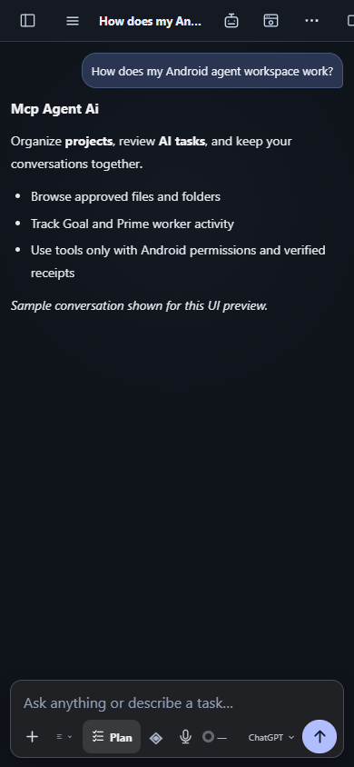
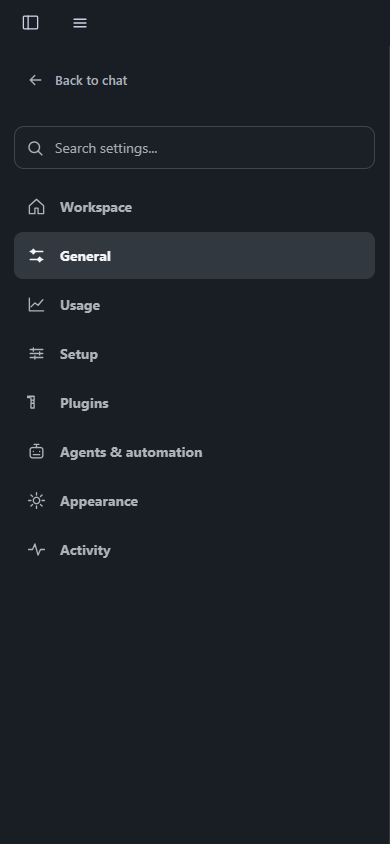
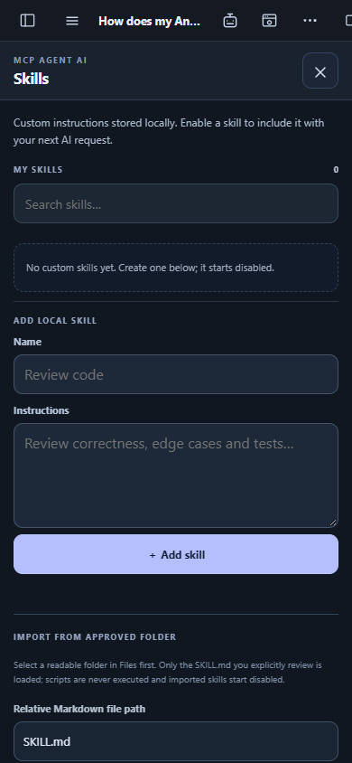

# Mcp Agent Ai

**An Android AI agent workspace with ChatGPT sign-in, local tools, projects, private browsing, skills and MCP integration.**

> Preview 0.2.2 · Android 8.0+ (API 26) · ARM64 (arm64-v8a). This is an Android app, not a Windows desktop program.

## Screenshots







*Screenshots are reproducible UI previews from the Android layout test harness; OS permission prompts and actual device content may differ.*

## Install

1. Get **Mcp-Agent-Ai-Android.apk** from a published GitHub release, when available, or build it yourself using the steps below.
2. On a compatible ARM64 Android phone, open the APK and allow installation from your chosen file manager when Android asks.
3. Open **Mcp Agent Ai → Settings → Setup**. Grant only the permissions needed for the tools you want to use. Accessibility and screen access are controlled by Android.
4. Sign in using the app's ChatGPT authorization flow, or configure a supported API provider and model. A saved credential is not proof that a reply or tool call has succeeded.
5. Choose a project and optionally share a folder using Android's system folder picker. Enable individual plugin capabilities only when needed.

**Updating an existing installation:** install the same-signed APK over the existing app. Do not uninstall or clear app data if you need to retain chats, settings, and folder grants. Preview builds may be debug-signed and may not upgrade a differently signed release.

## What you can do

- **Chat:** save conversations, search chat history, use normal messages and manually reviewed Goal or Plan workflows. Prime can coordinate up to two explicit provider-backed workers with verified lifecycle and history.
- **Browser:** use an app-owned private Android browser with HTTPS navigation, tabs, back/forward and a native right-side drawer. It uses its own WebView data profile rather than your personal Chrome cookies.
- **Android tools:** explicitly approve supported app, browser, file, terminal, and automation actions. Actual availability depends on Android permissions and the current app session.
- **Files and projects:** organize conversations, work with app-private files, and grant a specific phone folder using Android's Storage Access Framework.
- **Plugins and MCP:** inspect bundled native plugin capabilities, enable or disable them separately, and connect to supported MCP endpoints and the OpenAI Secure MCP Tunnel when configured.
- **Skills and pets:** create or import reviewed Markdown instruction skills; enable them individually. Choose from animated in-app pets and reposition one on the chat screen.
- **Settings:** change follow-output behavior, choose whether follow-ups are sent automatically after a verified turn or saved as a draft, configure finished-turn notifications, and adjust appearance.

## Optional downloads and current limits

- **Node.js and npm:** not bundled inside the APK. Use **Termux** with its own Node.js package if you need a user-operated Node/npm terminal. The Android app does not silently execute commands inside Termux.
- **SSH server projects:** the project picker currently supports local project groups and phone folders; authenticated remote SSH project transport is not yet available inside the app.
- **GeckoView extensions:** the bundled Android browser supports its own compatible extension manager; desktop Chrome/CRX extensions are not Android WebView extensions.
- **AI models:** API access may require a separate account, key, and network connection. Model usage, token billing, continuous autonomous Loop execution, all-language toolchains, third-party plugin auto-updates and full COS desktop parity are not promised in this preview.

## Build from source (Windows development host)

Install **Node.js 22+**, **Rust** with the `aarch64-linux-android` target, **JDK 21**, **Android SDK**, **Android NDK**, and a compatible Gradle environment. Set `JAVA_HOME`, `ANDROID_HOME`, and `NDK_HOME` to your installed SDK paths.

```powershell
npm ci
npm run typecheck
npm test
npm run qa:ui
cargo test --offline --manifest-path native-core/Cargo.toml --lib
cargo test --offline --manifest-path src-tauri/Cargo.toml --lib
npm run native:android
```

The output is `release/Mcp-Agent-Ai-Android.apk`. A Windows host is used for development and QA only; the product target is Android. A manual GitHub Actions workflow is available at `.github/workflows/android-preview.yml`.

## Security and state

Native permissions, model tool proposals, browser DOM access and OS grants require explicit user approval where applicable. The UI only shows a connection as verified when the corresponding native/backend receipt supports it. Browser cookies remain in the app-owned profile; tools must not import personal Chrome credentials. Running jobs interrupted by a process restart must not be silently resumed or marked successful.

See [Android migration notes](docs/NATIVE-MIGRATION.md), [browser design](docs/BROWSER-ENGINE-DESIGN.md), and the [COS parity matrix](docs/COS-ANDROID-PARITY-MATRIX.md) for implementation details, tests, and remaining gaps.
