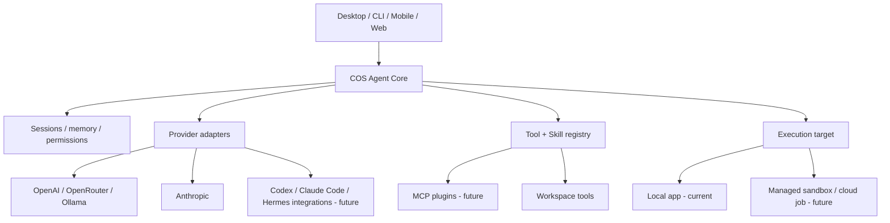

# COS Fusion — reka bentuk generasi baharu

## Keputusan produk

COS patut menjadi **agent workspace**, bukan sekadar tingkap ChatGPT + MCP. Ada satu pemilik sesi, aktiviti tool, kebenaran, riwayat, model routing dan persekitaran execution. UI desktop, CLI atau web ialah klien kepada pemilik yang sama. Plugin boleh ditambah/dibuang tanpa menukar core.

Gabungan ciri daripada produk lain bermaksud **menggunakan interface dan idea yang disokong**, bukan menggabungkan kod proprietary atau berpura-pura langganan ChatGPT/Claude memberi akses API tanpa kos tambahan.

| Sumber idea | Apa yang hendak dicapai dalam COS | Integrasi yang sesuai |
| --- | --- | --- |
| Codex | agent coding dengan sandbox, diff, approval, test, thread resume | Codex app-server / SDK adapter; core COS kekal owner UI dan sesi |
| Claude Code | custom agents, hooks, skills, permissions | adapter Claude Code melalui interface rasmi jika sesuai; Anthropic Messages sebagai adapter model langsung |
| Hermes | memory, toolsets, scheduled tasks, plugin dan execution fleksibel | CLI one-shot JSONL dengan session resume dan toggle External agents (v0.2.2); gateway lanjutan kemudian |
| COS lama | live browser, MCP tools, desktop, UI timeline, project control | port subsistem yang diaudit satu demi satu selepas core stabil |

## Bentuk seni bina

Tidak perlu laptop sebagai VPS: GUI boleh buka/tutup secara normal. Jika tugasan mesti terus berjalan apabila laptop dimatikan, COS menyerahkan job kepada remote runner atau API managed execution dan menyimpan status/job receipt di cloud. Ini perlukan akaun, sambungan, perkhidmatan pengiraan dan biasanya kos. File/desktop tempatan tidak boleh dicapai sewaktu laptop offline tanpa agen peranti sendiri yang aktif.

## Batasan keselamatan dan pemilikan

1. Agent core memiliki identiti sesi, tool receipt, status dan pembatalan. Adapter model tidak boleh memberikan hak fail/desktop.
2. Tool memeriksa izin pada **masa pelaksanaan**: disabling selepas prompt disediakan masih menghalang tool.
3. Setiap runner membawa ID job dan owner yang boleh dipadankan. Server/cloud tidak boleh melaporkan success berdasarkan request submission sahaja.
4. Plugin executable pihak ketiga memerlukan proses sandbox terasing, manifest keizinan, signature/provenance dan UX approval. Dalam versi 0.1 hanya skills Markdown dan dua modul built-in tersedia.
5. Keys dalam OS credential vault pada aplikasi penuh; tiada keys di renderer atau fail state. Sambungan cloud perlu dipisahkan daripada sesi browser peribadi.
6. Agent memory perlu mudah disemak, dieksport dan dipadam. Tiada auto-memory/cron berkuasa tinggi dihidupkan tanpa pilihan pengguna.

## Binaan berperingkat

1. **v0.1 (repositori ini):** agent loop, provider, tools, modul, skills dan ujian protokol.
2. **v0.2:** adapter Codex app-server, Claude Code native, hooks, runner process isolation, encrypted state, live streaming dan audit log.
3. **v0.3:** desktop Electron baharu, project tree, terminal, multiple agent views, diff/approval dan live browser milik COS.
4. **v0.4:** plugin SDK + marketplace, MCP gateway, memory, cron, subagents, selective migration dari COS lama.
5. **v0.5:** cloud job provider (sandbox bersesuaian), persistent tasks, sync, reconnect, billing guard serta pengujian bila laptop offline.

Setiap milestone memerlukan ujian live yang berasingan: source lulus ujian tempatan tidak membuktikan fungsi provider/cloud/device sudah tersedia.
